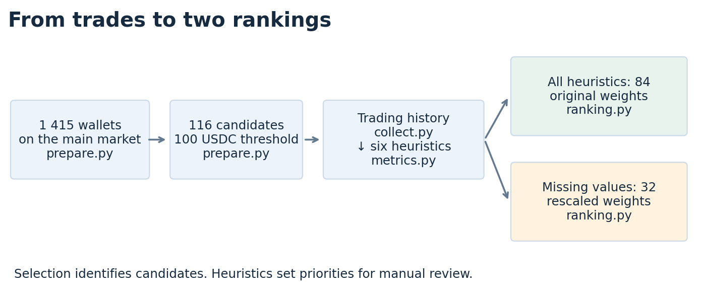
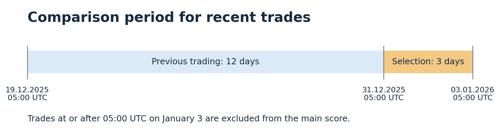
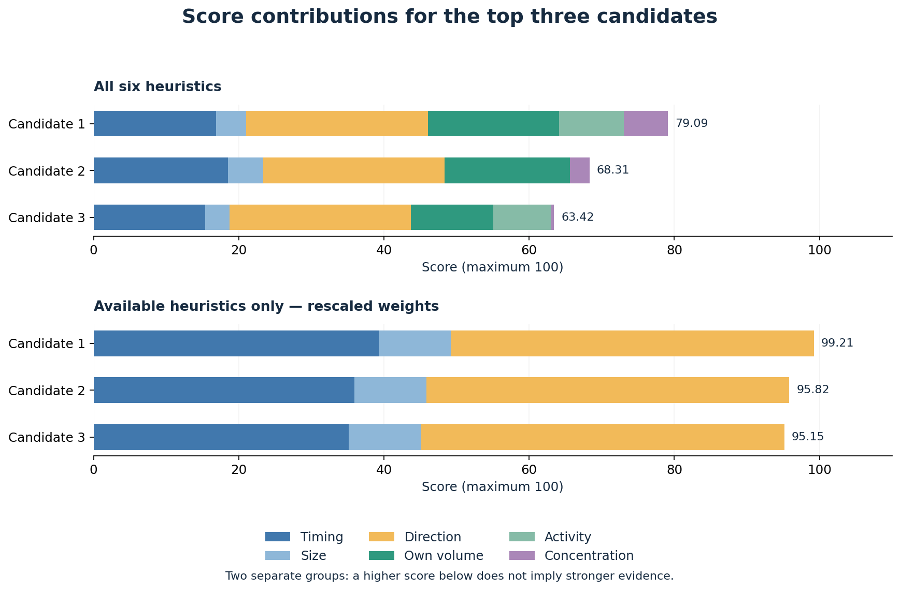

# Analysis of the Polymarket market on Maduro leaving office

Other versions: [full report in Russian](README_rus.md), [short report in English](short_report.md), and [short report in Russian](short_report_rus.md).

## Contents

1. [Purpose of the analysis](#1-purpose-of-the-analysis)
2. [Data sources](#2-data-sources)
   - [2.1. Trades and data preparation](#21-trades-and-data-preparation)
   - [2.2. Choosing the cutoff](#22-choosing-the-cutoff)
3. [Candidate selection and scoring](#3-candidate-selection-and-scoring)
   - [3.1. Initial wallet selection](#31-initial-wallet-selection)
   - [3.2. Candidate trading history](#32-candidate-trading-history)
   - [3.3. Calculating six heuristics](#33-calculating-six-heuristics)
   - [3.4. Building two rankings](#34-building-two-rankings)
4. [Results and their robustness](#4-results-and-their-robustness)
   - [4.1. Public mentions of candidates](#41-public-mentions-of-candidates)
   - [4.2. Changes under alternative assumptions](#42-changes-under-alternative-assumptions)
5. [Rerunning the analysis](#5-rerunning-the-analysis)

## 1. Purpose of the analysis

The aim is to identify wallets whose trading before the events of January 3, 2026 in Venezuela warrants further investigation. The main Polymarket market is **“Will Maduro leave office by January 31, 2026?”** YES represents a bet on his departure; NO represents the opposite outcome.

Wallets with substantial trading in favor of Maduro's departure are selected. Their recent trading is compared with their previous behavior, producing two candidate rankings. **116 candidates were selected: 84 with all six heuristics available and 32 with missing values.**



All parameters, including dates, thresholds, weights, and main market identifiers, are in [config.json](config.json). This version analyzes the maker side of trades; participants who traded only as takers are not included in the selection.

## 2. Data sources

### 2.1. Trades and data preparation

[src/collect.py](src/collect.py) queries CryptoHouse, a public mirror of Polymarket records, through [ClickHouse](https://crypto-clickhouse.clickhouse.com/). The current market dataset contains **19,911 fills on the main market**, from December 27, 2025 to the start of January 4, 2026. An order can be filled in parts; each fill is stored as a separate row.

The main market data was extracted from a previously saved dataset: other markets were excluded, and the fields of the remaining trades were preserved. No new database queries were executed for this step.

`data/source/raw/` contains JSON files; `data/source/sql/` contains the corresponding SQL queries for collecting the main market. Market JSON files are marked as filtered data (`origin_kind`). The SQL files were prepared for the narrower dataset; they do not represent newly executed queries. Numbers in filenames identify pages.

| Filenames in these directories | Contents |
|---|---|
| `fills_*.json` / `.sql` | Pages of main market fills after filtering. |
| `coverage_count.json` / `.sql` | Remaining fill count and time boundaries, recalculated after filtering. |
| `token_mapping.json` / `.sql` | Mapping from share identifiers to markets and YES/NO outcomes. |
| `server_timezone.json` / `.sql` | Database time zone check. |

From these responses, `collect.py` builds tables in `data/prepared/`: [fills.csv](data/prepared/fills.csv) with original trade fields, [token_mapping.csv](data/prepared/token_mapping.csv) with share mappings, and [coverage.csv](data/prepared/coverage.csv) with overall counts and dataset dates.

[src/prepare.py](src/prepare.py) converts raw amounts into USDC and share quantities, identifies buys and sells, and saves [trades.csv](data/prepared/trades.csv).

[src/verify.py](src/verify.py) checks source responses, tables, trade directions, and calculations. It also creates [daily_coverage.csv](data/prepared/daily_coverage.csv): fill counts by day, market, and direction.

[data/provenance.json](data/provenance.json) stores query details and source file checksums. It also records the snapshot used to extract the main market and the number of removed rows. [data/prepared/run_log.json](data/prepared/run_log.json) stores program results: candidate counts, calculation parameters, and validation outcomes.

### 2.2. Choosing the cutoff

News, eyewitness accounts, and official documents were collected before scoring to establish what information was public and when market participants might have started reacting. Events and links are stored in the manually compiled [information_timeline.csv](data/prepared/information_timeline.csv).

Three reference points from this timeline:

| Time on January 3, UTC | Meaning |
|---|---|
| 06:00 | Start of an [FAA airspace restriction](https://notams.aim.faa.gov/notamSearch/createNotamPdf?download=true&transactionid=79311384) citing military activity; its first publication time has not been established. |
| 06:05 | A photographer's observation time reported in a later [AP account](https://apnews.com/article/a984d5852ebfbe355215539b846826b0). This is the event time, not the news publication time. |
| Around 09:21 | Time of the presidential announcement given in a later [charging document](https://www.justice.gov/usao-sdny/media/1437781/dl). |

The main calculation uses **05:00 UTC, one hour before the first reference point**. This is a working cutoff, not an established time of the first rumor: other reports may have appeared earlier. Robustness is therefore also checked at 04:00 and 06:00. Expectations of escalation had already been discussed in public news before January 3.

The selection window is the three days before 05:00; the comparison period is the preceding 12 days. Trades at or after the cutoff are excluded.



## 3. Candidate selection and scoring

### 3.1. Initial wallet selection

For each wallet, **YES buys and NO sells** are summed over three days. Buying YES is a bet on Maduro's departure. Selling NO reduces exposure to the opposite outcome, but may simply sell previously purchased shares rather than represent a new bet on his departure. Wallets with a total of at least **100 USDC** are selected. This is a broad screen: opposite trades are not subtracted at this stage. They are considered later in the direction heuristic.

Of 1,415 observed wallets, `prepare.py` selects 116. It saves the following in `data/prepared/`:

| File | Contents |
|---|---|
| [screening.csv](data/prepared/screening.csv) | All 1,415 wallets, their amounts, and selection decisions. |
| [candidates.csv](data/prepared/candidates.csv) | The 116 selected wallets, used for subsequent history collection. |
| [screening_sensitivity.csv](data/prepared/screening_sensitivity.csv) | Changes in candidate counts under alternative dates, windows, and thresholds: 36 combinations. |

### 3.2. Candidate trading history

`collect.py` collects maker trades for these 116 wallets **across all markets** to establish their previous trading scale and behavior. The requested period runs from December 1, 2025 to January 3, 2026, 06:00 UTC. It contains 541,060 saved fills. The final hour supports the alternative cutoff check and does not contribute to the main score.

The source has no records for December 1–17, so the main comparison period starts on December 19 at 05:00. Unavailable days cannot be treated as days without trading. Missing history in this period does not prove that a wallet is new.

Raw history pages are also stored in `data/source/`. Their names begin with `history_`; the variable part identifies the collected dataset.

| Filename ending (`.json` and corresponding `.sql`) | Purpose |
|---|---|
| `*_day_*_fills_*` | Candidate trades split into days and pages. |
| `*_tokens_*` | Historical share mappings: YES and NO for the same market must not count as separate markets. |
| `*_counts`, `*_daily_counts` | Expected overall and daily trade counts, used to check page completeness. |
| `*_source_daily_bounds`, `*_timezone` | Daily availability of the source database and its time zone. |
| `history_connection_check`, `history_page_limit_check` | Connection and allowed page size checks; only SQL is saved for the latter. |

From these responses, `collect.py` creates five tables in `data/prepared/`:

| File | Contents |
|---|---|
| [history_fills.csv](data/prepared/history_fills.csv) | Historical fills with original fields. |
| [history_trades.csv](data/prepared/history_trades.csv) | The same data with buys, sells, and amounts identified; input for the heuristics. |
| [history_token_mapping.csv](data/prepared/history_token_mapping.csv) | Mapping from historical shares to markets. |
| [history_coverage.csv](data/prepared/history_coverage.csv) | History found for each wallet. |
| [history_source_coverage.csv](data/prepared/history_source_coverage.csv) | Days with available records in the source itself. |

### 3.3. Calculating six heuristics

[src/metrics.py](src/metrics.py) assigns each metric a value from 0 to 1: higher values contribute more points. The output is [candidate_metrics.csv](data/prepared/candidate_metrics.csv). It includes metric values and supporting quantities: turnover, transaction frequency, previous volumes, and reasons for missing values.

| Heuristic | What raises the value | Calculation | Original weight |
|---|---|---|---:|
| **Timing** | Trades closer to 05:00 on January 3. | Each YES buy and NO sell receives a proximity value: 0 at the start of the three days, 1 at the end. The result is their average, weighted by trade amounts. | 20% |
| **Size** | YES BUY + NO SELL turnover higher than other participants'. | Percentile among all participants with positive turnover of this kind: position in the ordered list divided by the participant count. | 5% |
| **Direction** | Trading in favor of YES outweighs opposite trading. | Difference between YES BUY + NO SELL and YES SELL + NO BUY share quantities, divided by total shares traded. Negative results are set to zero. | 25% |
| **Own volume** | The wallet trades substantially larger amounts than before. | Ratio of current average daily turnover to its previous typical volume, separately for buys and sells. | 20% |
| **Activity** | Average daily transaction count rises in the last three days. | Frequency across all markets over three days relative to the preceding 12 days. | 15% |
| **Concentration** | A larger share of trading shifts to the main market. | Difference between the current and previous main market shares of turnover across all markets. Negative results are set to zero. Buys and sells are combined. | 15% |

For own volume, trades by one wallet on one market on one day are first summed. The median of these sums over the preceding 12 days is its typical volume. Buys and sells are calculated separately. Days without trading are excluded from the median. Current YES buy and NO sell amounts are divided by three days. These daily averages are compared with the corresponding medians. When both directions are used, the result is the average of the two ratios, weighted by their current amounts.

Activity compares **average daily transaction counts** over the last three days and the preceding 12 days. For example, 24 transactions over 12 days is 2 per day, while 18 over three days is 6 per day: frequency tripled. All days, including days without trading, and all markets are included. Counting unique transactions prevents partial fills of one order from inflating the value.

For own volume and activity, the current-to-previous ratio is converted into a metric value using **max(0, (ratio − 1) / (ratio + 1))**. No growth gives 0; doubling gives 0.33; a tenfold increase gives 0.82.

**When is history insufficient?** Own volume requires at least three distinct trading days and five “one market on one day” sums. For example, buys on two markets on Monday, two on Tuesday, and one on Wednesday yield five sums over three days. Five fills on one market on Monday yield only one sum.

This condition is checked separately for previous buys and sells. If current trading includes only YES buys, buy history is needed; if it also includes NO sells, sell history is needed as well. If any required direction has insufficient history, own volume is not calculated.

Activity requires at least three trading days and five previous transactions. Concentration requires three days, ten transactions, and nonzero turnover in both comparison periods. These minimums are set in `config.json`. If a requirement is not met, the metric is left blank because data is insufficient. A zero means something different: data is available, but the metric contributes no points.

### 3.4. Building two rankings

[src/ranking.py](src/ranking.py) combines metric values using the weights in the table. The weights reflect expert judgment: direction and changes in the wallet's own behavior carry more weight than trading size. They are not trained on confirmed insider trading examples; some metrics may reflect the same behavior.

**84 wallets** have all six heuristics available. Their score is **100 × sum(metric value × weight)**. **32 wallets** have missing values. For each such wallet, unavailable heuristics are excluded and the remaining weights are increased proportionally to sum to 100%.

For example, if only timing, size, and direction are available, their weights of 20%, 5%, and 25% become **40%, 10%, and 50%**. If all three values are 0.5, the final score is 50. Missing data therefore does not reduce the maximum possible score.

| Output in `results/` | What to open |
|---|---|
| [ranking_complete.csv](results/ranking_complete.csv) | Ranking of 84 wallets with all heuristics. |
| [ranking_incomplete.csv](results/ranking_incomplete.csv) | Ranking of 32 wallets with missing values. |
| [ranking.csv](results/ranking.csv) | Both rankings together. `verify.py` uses it to check formulas and group membership; `ranking.py` uses it for scenario comparisons. Ranks remain separate within each group. |

In each group, the highest unrounded score receives first place. Equal scores share a rank; the address only determines row order in a tie. `ranking_group` identifies the group, `rank` the position within it, and `score` the final score. `missing_metrics` lists missing values, `effective_weight_*` records the weights used, and `contribution_*` records each heuristic's contribution.

`coverage_percent` is the sum of the **original** weights of available heuristics. For example, 50% means metrics representing half the original total weight could be calculated.

Two auxiliary fields help assess the effect of weight rescaling. Suppose half the original weight is available and the score before rescaling is 30. Then `supported_score` is **30**, while the final `score` is **60**. The difference shows how much rescaling raised the score.

In the same example, `supported_score_upper_bound` is **80**: the 30 points already supported by data plus the 50 that missing metrics could contribute at their maximum values. This is an upper bound on the original six-heuristic sum, not a forecast or a bound on the final score of 60. `verify.py` checks this arithmetic; the field does not affect rank.

**Scores from different groups are not suitable for direct comparison.** Even within the second group, available metric sets may differ, so interpreting a candidate requires checking what its score is based on.

## 4. Results and their robustness

The first three candidates in each group are shown below. Colors represent heuristic contributions; the table links chart numbers to wallets. Address links open their transactions on PolygonScan.



| Group | Candidate on chart | Wallet | Score |
|---|---:|---|---:|
| All heuristics | 1 | [0xe194c638…cd47](https://polygonscan.com/address/0xe194c638670b0a0acedc8efa00fc1c98aa49cd47) | 79.09 |
| All heuristics | 2 | [0x858d551d…1047](https://polygonscan.com/address/0x858d551d073e9c647c17079ad9021de830201047) | 68.31 |
| All heuristics | 3 | [0xee213de5…e2fe](https://polygonscan.com/address/0xee213de5ec7ab93c72bcad3c2c76552cb56de2fe) | 63.42 |
| Missing values | 1 | [0x6baf05d1…94c5](https://polygonscan.com/address/0x6baf05d193692bb208d616709e27442c910a94c5) | 99.21 |
| Missing values | 2 | [0xa72db174…ebd4](https://polygonscan.com/address/0xa72db1749e9ac2379d49a3c12708325ed17febd4) | 95.82 |
| Missing values | 3 | [0x31a56e9e…8ed9](https://polygonscan.com/address/0x31a56e9e690c621ed21de08cb559e9524cdb8ed9) | 95.15 |

The complete group's leader scored 79.09, with positive values for all six heuristics. Its largest contributions are direction (25 points), own volume (18.07), and timing (16.87). The incomplete group's leader scored 99.21 using only timing, size, and direction. It lacks sufficient data for the three historical heuristics. These two scores therefore cannot establish which wallet is more suspicious.

### 4.1. Public mentions of candidates

Searching the addresses and public usernames of the first five wallets in each ranking produced the findings below. This information was not used in scoring.

**The first three wallets in the group with missing values had already been discussed together.** [BlockBeats](https://www.binance.com/en/square/post/34623684785378) gives their full addresses and estimates profits on Maduro bets: `0x6baf…94c5` — $145.6K, `0xa72d…ebd4` — $75K, and `0x31a5…8ed9` — $409.9K. [Lookonchain](https://www.binance.com/en/square/post/34612412913490) also discussed three accounts with these results and suggested they had used nonpublic information.

[Odaily links](https://www.binance.com/en/square/post/315888847860113) `0x31a5…8ed9` to servicemember Gannon Ken Van Dyke. The [U.S. Department of Justice](https://www.justice.gov/opa/pr/us-soldier-charged-using-classified-information-profit-prediction-market-bets) confirmed charges against him for using classified information to place bets, but did not include the full address in its announcement.

In the complete group, the second wallet, `0x858d…1047`, has the username [flipfloppity](https://polymarket.com/pt/profile/0x858d551d073e9c647c17079ad9021de830201047); the fourth, `0x4fd3…ef31`, has the username [ToyotaYaris](https://polymarket.com/profile/0x4fd3503c78bd1ececdbe034a4dfe156ce659ef31). [Prism News](https://www.prismnews.com/news/study-finds-143-million-in-suspected-insider-trading-on) mentions flipfloppity in an analysis of suspicious Iran bets. This remains a lead: the site uses automated news generation, and neither the original analysis nor a full address match could be verified. No substantive discussions were found for ToyotaYaris or the other five wallets.

### 4.2. Changes under alternative assumptions

`ranking.py` checks 15 scenarios: a one-hour cutoff shift, a one-day or one-week trading window, different weights, history requirements, selection thresholds, and two alternative treatments of missing values. Each scenario changes one set of conditions while keeping the others fixed.

The complete group's leader remains first in **8 of the 10 scenarios varying the window, cutoff, weights, and history requirements**, including the main calculation. Under the weekly window and strict requirements, it moves to the group with missing values because its history no longer meets the requirements. The incomplete group's leader remains first in 9 of those 10 scenarios; removing timing puts another wallet first. Rank therefore depends partly on the selected weights.

The broader selection check is limited by collected history: the weekly window adds **83 wallets** without collected history. A complete ranking of all weekly candidates was therefore not calculated.

| File | Purpose |
|---|---|
| [results/sensitivity.csv](results/sensitivity.csv) | 30 summaries: 15 scenarios × 2 groups. Shows the leader, group size, and overlap with the main top ten. |
| [data/prepared/sensitivity_rankings.csv](data/prepared/sensitivity_rankings.csv) | All 1,740 wallet–scenario rows: metric values, group, and rank. Supports investigation of individual changes. |
| [results/candidate_stability.csv](results/candidate_stability.csv) | Each wallet's best and worst rank and top-ten appearance count, separately for each group. |

`verify.py` checks formulas, group membership, ranks, and scenario results. Validation outcomes are recorded in `data/prepared/run_log.json`. Checks of the saved calculations passed.

The next substantive step is to examine the leading wallets' trades against the public timeline. Scores alone cannot distinguish access to nonpublic information from successful speculation, hedging, or an ordinary change in trading strategy.

All three illustrations are generated by [src/plot_report.py](src/plot_report.py) from settings and saved tables. It saves `process.png`, `timeline.png`, and `score_contributions.png` in `results/figures/`, showing the analysis flow, time windows, and score composition respectively. English versions use the `_en` suffix. The figures do not add anything to the calculations.

## 5. Rerunning the analysis

From the project directory, using Python 3.13:

```powershell
python -m pip install -r requirements.txt
python src/run.py
python src/plot_report.py
```

[requirements.txt](requirements.txt) pins library versions. [src/run.py](src/run.py) runs data preparation, selection, heuristic calculations, rankings, and validation in order. By default it uses saved data without accessing the network. The second Python command updates the figures.

To check saved calculations only: `python src/verify.py`. To explicitly collect market data: `python src/run.py --collect --stage prepare`; candidate history: `python src/run.py --stage collect-history`. Collection reuses saved responses, so these commands do not guarantee a fresh network download. If selection changes, history must be available for the new candidate set before recalculating heuristics.


## GitHub submission packaging

The two history CSVs exceed GitHub’s regular file-size limit. They are included as header-bearing CSV parts in `data/prepared/history_fills_parts/` and `data/prepared/history_trades_parts/`. `data/prepared/csv_parts_manifest.json` records the part hashes and the hashes of the original tables. The existing commands automatically restore byte-identical tables on first use; no network access is required. To restore them explicitly, run `python src/restore_csv.py`. Scores, source responses, and methodology are unchanged.
