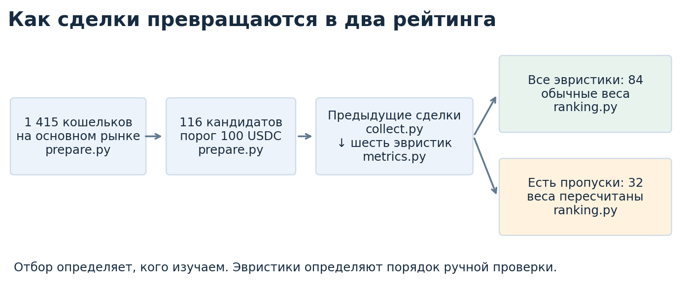

# Анализ рынка Polymarket об уходе Мадуро

## Содержание

1. [Цель анализа](#1-цель-анализа)
2. [Откуда взяты данные](#2-откуда-взяты-данные)
   - [2.1. Сделки и их подготовка](#21-сделки-и-их-подготовка)
   - [2.2. Выбор временной границы](#22-выбор-временной-границы)
3. [Отбор и оценка кандидатов](#3-отбор-и-оценка-кандидатов)
   - [3.1. Первичный отбор кошельков](#31-первичный-отбор-кошельков)
   - [3.2. История сделок кандидатов](#32-история-сделок-кандидатов)
   - [3.3. Расчет шести эвристик](#33-расчет-шести-эвристик)
   - [3.4. Построение двух рейтингов](#34-построение-двух-рейтингов)
4. [Что получилось и насколько результат устойчив](#4-что-получилось-и-насколько-результат-устойчив)
   - [4.1. Публичные упоминания кандидатов](#41-публичные-упоминания-кандидатов)
   - [4.2. Что меняется при других условиях](#42-что-меняется-при-других-условиях)
5. [Как повторить анализ](#5-как-повторить-анализ)

## 1. Цель анализа

Цель анализа — найти кошельки, чья торговля перед событиями 3 января 2026 года в Венесуэле заслуживает дополнительной проверки. Основной рынок Polymarket — **«Уйдет ли Мадуро до 31 января 2026 года?»** На нем YES означает ставку на уход, NO — на противоположный исход.

В отбор входят кошельки с заметной торговлей в пользу ухода Мадуро. Их недавняя торговля сравнивается с предыдущей; по результатам строятся два рейтинга. Отобраны **116 кандидатов: 84 со всеми шестью эвристиками и 32 с пропусками**.



Все параметры — даты, пороги, веса и идентификаторы основного рынка — находятся в [config.json](config.json). В этой версии анализируется maker-сторона сделок; участники, торговавшие только как taker, в отбор не входят.

## 2. Откуда взяты данные

### 2.1. Сделки и их подготовка

[src/collect.py](src/collect.py) запрашивает публичную базу CryptoHouse — зеркало записей Polymarket — через [ClickHouse](https://crypto-clickhouse.clickhouse.com/). В текущей рыночной выгрузке **19 911 исполнений сделок основного рынка** за период с 27 декабря 2025 года до начала 4 января 2026 года. Один ордер может исполняться частями: каждая часть сохраняется отдельной строкой.

Текущие данные основного рынка выделены из ранее сохраненной выгрузки: остальные рынки исключены, поля оставшихся сделок сохранены без изменений. Новые запросы к базе для этого не выполнялись.

В `data/source/raw/` лежат JSON-файлы, в `data/source/sql/` — соответствующие SQL-запросы для сбора основного рынка. Рыночные JSON помечены как результат фильтрации (`origin_kind`); эти SQL подготовлены для узкого набора данных, а не выданы за заново выполненные запросы. Номер в имени обозначает страницу.

| Имена файлов в этих папках | Что содержат |
|---|---|
| `fills_*.json` / `.sql` | Страницы исполнений на основном рынке после фильтрации. |
| `coverage_count.json` / `.sql` | Число оставшихся исполнений и границы времени, пересчитанные после фильтрации. |
| `token_mapping.json` / `.sql` | Связь идентификаторов долей с рынками и исходами YES/NO. |
| `server_timezone.json` / `.sql` | Проверку часового пояса базы. |

Из ответов `collect.py` собирает таблицы в `data/prepared/`: [fills.csv](data/prepared/fills.csv) с исходными полями сделок, [token_mapping.csv](data/prepared/token_mapping.csv) с привязкой долей и [coverage.csv](data/prepared/coverage.csv) с общими числами и датами выгрузки.

[src/prepare.py](src/prepare.py) преобразует исходные суммы в USDC и количество долей, определяет покупки и продажи и сохраняет [trades.csv](data/prepared/trades.csv). 

[src/verify.py](src/verify.py) сверяет исходные ответы, таблицы, направления сделок и расчеты. Он также создает [daily_coverage.csv](data/prepared/daily_coverage.csv): число исполнений по дням, рынкам и направлениям.

[data/provenance.json](data/provenance.json) хранит сведения о запросах и контрольные суммы исходных файлов. В нем также записано, из какого снимка выделены данные основного рынка и сколько строк удалено. [data/prepared/run_log.json](data/prepared/run_log.json) хранит уже результаты работы программы: числа кандидатов, параметры расчетов и итоги проверок.

### 2.2. Выбор временной границы

Перед расчетом были собраны новости, сообщения очевидцев и официальные документы. Цель — понять, какие сведения были публичными и когда могли начаться реакции участников рынка. События и ссылки сохранены в составленной вручную таблице [information_timeline.csv](data/prepared/information_timeline.csv).

Три ориентира из этой хронологии:

| Время 3 января, UTC | Что означает |
|---|---|
| 06:00 | Начало действия [авиационного ограничения FAA](https://notams.aim.faa.gov/notamSearch/createNotamPdf?download=true&transactionid=79311384) со ссылкой на военную активность; время его первой публикации не установлено. |
| 06:05 | Время наблюдения фотографа, приведенное в позднейшем [рассказе AP](https://apnews.com/article/a984d5852ebfbe355215539b846826b0). Это время события, а не публикации новости. |
| Около 09:21 | Время президентского объявления, указанное в позднейшем [документе обвинения](https://www.justice.gov/usao-sdny/media/1437781/dl). |

Граница основного расчета — **05:00 UTC, за час до первого из этих ориентиров**. Это рабочая граница, а не установленное время первого слуха: ранее могли появиться другие сообщения. Поэтому устойчивость результата дополнительно проверяется при границах 04:00 и 06:00. Ожидания эскалации обсуждались в публичных новостях еще до 3 января.

Период отбора — трое суток перед 05:00; период сравнения — предшествующие 12 суток. Сделки в момент отсечки и позже в расчет не входят.


## 3. Отбор и оценка кандидатов

### 3.1. Первичный отбор кошельков

Для каждого кошелька рассчитывается сумма **покупок YES и продаж NO** за трое суток. Покупка YES означает ставку на уход Мадуро. Продажа NO уменьшает ставку на противоположный исход, но может означать лишь продажу ранее купленных долей, а не новую ставку на уход. В отбор входят кошельки с суммой не менее **100 USDC**. Это широкий отбор: обратные сделки на этом шаге не вычитаются. Они учитываются позже в эвристике направленности.

Из 1 415 наблюдаемых кошельков `prepare.py` выбирает 116. В `data/prepared/` он сохраняет:

| Файл | Что в нем |
|---|---|
| [screening.csv](data/prepared/screening.csv) | Все 1 415 кошельков, их суммы и решение об отборе. |
| [candidates.csv](data/prepared/candidates.csv) | 116 выбранных кошельков. Это список для дальнейшего сбора истории. |
| [screening_sensitivity.csv](data/prepared/screening_sensitivity.csv) | Как меняется число отобранных кошельков при других датах, периодах и порогах: 36 сочетаний условий. |

### 3.2. История сделок кандидатов

`collect.py` собирает maker-сделки этих 116 кошельков **на всех рынках**, чтобы понять их предыдущий масштаб и характер торговли. Запрошен период с 1 декабря 2025 года до 3 января 2026 года, 06:00 UTC. В нем сохранены 541 060 исполнений. Последний час нужен для проверки альтернативной отсечки, а в основной балл не входит.

В источнике нет записей за 1–17 декабря, поэтому основной период сравнения начинается 19 декабря в 05:00. Недоступные дни нельзя считать днями без торговли. Отсутствие истории в этом периоде не доказывает, что кошелек новый.

Исходные страницы этой истории тоже находятся в `data/source/`. Их имена начинаются с `history_`; переменная часть имени обозначает набор собранных данных.

| Окончание имени (`.json` и соответствующий `.sql`) | Назначение |
|---|---|
| `*_day_*_fills_*` | Сделки кандидатов, разбитые на дни и страницы. |
| `*_tokens_*` | Привязка исторических долей к рынкам: YES и NO одного рынка не должны считаться разными рынками. |
| `*_counts`, `*_daily_counts` | Ожидаемое число сделок всего и по дням — для проверки полноты страниц. |
| `*_source_daily_bounds`, `*_timezone` | Доступность всей базы по дням и ее часовой пояс. |
| `history_connection_check`, `history_page_limit_check` | Проверки соединения и допустимого размера страницы; у второй сохранен только SQL. |

Из этих ответов `collect.py` создает пять таблиц в `data/prepared/`:

| Файл | Что в нем |
|---|---|
| [history_fills.csv](data/prepared/history_fills.csv) | Исторические исполнения с исходными полями. |
| [history_trades.csv](data/prepared/history_trades.csv) | Те же данные после определения покупок, продаж и сумм; вход для эвристик. |
| [history_token_mapping.csv](data/prepared/history_token_mapping.csv) | Соответствие исторических долей рынкам. |
| [history_coverage.csv](data/prepared/history_coverage.csv) | Сколько истории найдено у каждого кошелька. |
| [history_source_coverage.csv](data/prepared/history_source_coverage.csv) | В какие дни записи доступны в самом источнике. |

### 3.3. Расчет шести эвристик

[src/metrics.py](src/metrics.py) рассчитывает каждый признак от 0 до 1: большее значение дает больше баллов. Результат — [candidate_metrics.csv](data/prepared/candidate_metrics.csv). В нем есть сами оценки и поясняющие числа: обороты, частота транзакций, предыдущие объемы и причины пропусков.

| Эвристика | Что повышает оценку | Способ расчета | Исходный вес |
|---|---|---|---:|
| **Время** | Сделки ближе к 05:00 3 января. | Каждая покупка YES и продажа NO получает оценку близости к отсечке: 0 в начале трех суток, 1 в конце. Итог — среднее этих оценок с весами сумм сделок. | 20% |
| **Размер** | Оборот YES BUY + NO SELL выше, чем у других. | Процентиль среди всех участников с положительным таким оборотом: место в упорядоченном списке, деленное на число участников. | 5% |
| **Направленность** | Торговля в пользу YES преобладает над обратной. | Разница между долями YES BUY + NO SELL и YES SELL + NO BUY, деленная на общее число проторгованных долей. Отрицательный результат заменяется нулем. | 25% |
| **Собственный объем** | Кошелек торгует заметно крупнее, чем раньше. | Отношение среднесуточного текущего оборота к предыдущему типичному объему, отдельно для покупок и продаж. | 20% |
| **Активность** | За последние трое суток выросло среднее число транзакций в день. | Частота на всех рынках за трое суток относительно частоты за предыдущие 12 суток. | 15% |
| **Концентрация** | Большая доля торговли переместилась на основной рынок. | Разница между текущей и предыдущей долями основного рынка в обороте всех рынков. Отрицательный результат заменяется нулем. Покупки и продажи учитываются вместе. | 15% |

Для эвристики собственного объема сделки одного кошелька на одном рынке за один день сначала суммируются. Медиана таких сумм за предыдущие 12 суток — его типичный объем. Покупки и продажи рассчитываются отдельно. Дни без торговли в медиану не входят. Суммы текущих покупок YES и продаж NO делятся на три дня. Полученные среднесуточные объемы сравниваются с соответствующими медианами. Если используются оба направления, итог — среднее двух отношений с весами текущих сумм.

Эвристика активности сравнивает **среднее число транзакций в день** за последние трое суток и предыдущие 12 суток. Например, 24 транзакции за 12 суток — 2 в день, а 18 за трое суток — 6 в день: частота выросла втрое. В расчет входят все дни, включая дни без торговли, и все рынки. Подсчет уникальных транзакций исключает увеличение оценки из-за исполнения одного ордера частями.

Для эвристик собственного объема и активности отношение текущего значения к предыдущему переводится в оценку по формуле **max(0, (отношение − 1) / (отношение + 1))**. Без роста оценка равна 0, при росте вдвое — 0,33, в десять раз — 0,82.

**Когда истории недостаточно?** Для эвристики собственного объема нужны минимум три разных дня торговли и пять сумм «один рынок за один день». Например, покупки на двух рынках в понедельник, двух во вторник и одном в среду дают пять таких сумм за три дня. Пять исполнений на одном рынке в понедельник дадут только одну сумму.

Это условие проверяется отдельно для предыдущих покупок и продаж: если сейчас есть только покупки YES, нужна история покупок; если есть и продажи NO — также история продаж. Если для любого используемого направления ее не хватает, эвристика собственного объема не рассчитывается.

Для эвристики активности нужны минимум три дня торговли и пять предыдущих транзакций; для эвристики концентрации — три дня, десять транзакций и ненулевой оборот в обоих сравниваемых периодах. Эти минимумы заданы в `config.json`. Если требование не выполнено, оценка остается пустой: данных не хватает. Нулевая оценка означает другое — данные есть, но признак не дал баллов.

### 3.4. Построение двух рейтингов

[src/ranking.py](src/ranking.py) складывает оценки с весами из таблицы. Веса выбраны экспертно: направленность и изменения собственного поведения имеют больший вес, чем размер торговли. Они не обучены на примерах доказанного инсайда; некоторые признаки могут отражать одно и то же поведение.

У **84 кошельков** доступны все шесть эвристик. Их балл: **100 × сумма(оценка × вес)**. У **32 кошельков** есть пропуски. Для каждого такого кошелька недоступные эвристики исключаются, а оставшиеся веса пропорционально увеличиваются до суммы 100%.

Например, если доступны только время, размер и направленность, их веса 20%, 5% и 25% превращаются в **40%, 10% и 50%**. Если все три оценки равны 0,5, итог — 50 баллов. Так недостаток данных не уменьшает максимальный возможный балл.

| Результат в `results/` | Что открывать |
|---|---|
| [ranking_complete.csv](results/ranking_complete.csv) | Рейтинг 84 кошельков со всеми эвристиками. |
| [ranking_incomplete.csv](results/ranking_incomplete.csv) | Рейтинг 32 кошельков с пропусками. |
| [ranking.csv](results/ranking.csv) | Оба рейтинга вместе. `verify.py` использует таблицу для проверки формул и состава групп, `ranking.py` — для сравнения сценариев. Места по-прежнему считаются отдельно в каждой группе. |

В каждой группе первое место получает самый высокий неокругленный балл. Одинаковые баллы делят место; адрес задает только порядок строк при равенстве. `ranking_group` обозначает группу, `rank` — место в ней, `score` — итоговый балл. `missing_metrics` перечисляет пропуски, `effective_weight_*` — использованные веса, `contribution_*` — вклад каждой эвристики.

`coverage_percent` показывает сумму **исходных** весов доступных эвристик. Например, 50% означает, что удалось рассчитать признаки с половиной первоначального веса.

Два вспомогательных поля помогают проверить влияние пересчета весов. Например, доступна половина исходного веса и до пересчета получено 30 баллов. Тогда `supported_score` равен **30**, а итоговый `score` — **60**. Разница показывает, насколько пересчет поднял оценку.

`supported_score_upper_bound` в том же примере равен **80**: 30 уже полученных баллов плюс 50, которые могли бы дать отсутствующие признаки при максимальных оценках. Это верхняя граница исходной суммы по шести эвристикам, а не прогноз и не граница итогового балла 60. `verify.py` проверяет эту арифметику; на место в рейтинге поле не влияет.

**Баллы разных групп не подходят для прямого сравнения.** Даже внутри второй группы наборы эвристик могут различаться, поэтому при разборе кандидата важно смотреть, на чем основан его балл.

## 4. Что получилось и насколько результат устойчив

Ниже — первые три кандидата каждой группы. Цвета показывают вклад эвристик; таблица связывает номера на графике с кошельками. По ссылке на адрес можно открыть его сделки в PolygonScan.


| Группа | Кандидат на графике | Кошелек | Балл |
|---|---:|---|---:|
| Все эвристики | 1 | [0xe194c638…cd47](https://polygonscan.com/address/0xe194c638670b0a0acedc8efa00fc1c98aa49cd47) | 79,09 |
| Все эвристики | 2 | [0x858d551d…1047](https://polygonscan.com/address/0x858d551d073e9c647c17079ad9021de830201047) | 68,31 |
| Все эвристики | 3 | [0xee213de5…e2fe](https://polygonscan.com/address/0xee213de5ec7ab93c72bcad3c2c76552cb56de2fe) | 63,42 |
| Есть пропуски | 1 | [0x6baf05d1…94c5](https://polygonscan.com/address/0x6baf05d193692bb208d616709e27442c910a94c5) | 99,21 |
| Есть пропуски | 2 | [0xa72db174…ebd4](https://polygonscan.com/address/0xa72db1749e9ac2379d49a3c12708325ed17febd4) | 95,82 |
| Есть пропуски | 3 | [0x31a56e9e…8ed9](https://polygonscan.com/address/0x31a56e9e690c621ed21de08cb559e9524cdb8ed9) | 95,15 |

Лидер полной группы получил 79,09: все шесть эвристик дали положительные оценки. Наибольшие вклады — направленность (25 баллов), собственный объем (18,07) и время (16,87). Лидер группы с пропусками получил 99,21 только по эвристикам времени, размера и направленности. Для трех исторических эвристик данных не хватает. Поэтому эти два балла нельзя использовать для определения, какой из двух кошельков подозрительнее.

### 4.1. Публичные упоминания кандидатов

Поиск по адресам и публичным никам первых пяти кошельков каждого рейтинга дал следующие результаты. Эти сведения не использовались при расчете баллов.

**Первые три кошелька группы с пропусками уже обсуждались вместе.** [BlockBeats](https://www.binance.com/en/square/post/34623684785378) приводит их полные адреса и оценивает прибыль на ставках по Мадуро: `0x6baf…94c5` — $145,6 тыс., `0xa72d…ebd4` — $75 тыс., `0x31a5…8ed9` — $409,9 тыс. [Lookonchain](https://www.binance.com/en/square/post/34612412913490) также обсуждал три аккаунта с такими результатами и предполагал использование закрытой информации.

Адрес `0x31a5…8ed9` [Odaily связывает](https://www.binance.com/en/square/post/315888847860113) с военнослужащим Gannon Ken Van Dyke. [Минюст США](https://www.justice.gov/opa/pr/us-soldier-charged-using-classified-information-profit-prediction-market-bets) подтвердил предъявление ему обвинений в использовании секретной информации для ставок, но полный адрес в сообщении не указан.

В полной группе у второго кошелька, `0x858d…1047`, найден ник [flipfloppity](https://polymarket.com/pt/profile/0x858d551d073e9c647c17079ad9021de830201047), у четвертого, `0x4fd3…ef31`, — [ToyotaYaris](https://polymarket.com/profile/0x4fd3503c78bd1ececdbe034a4dfe156ce659ef31). [Prism News](https://www.prismnews.com/news/study-finds-143-million-in-suspected-insider-trading-on) упоминает flipfloppity в разборе подозрительных ставок на Иран. Это пока зацепка: сайт использует автоматическую генерацию новостей, а первичный разбор и совпадение полного адреса подтвердить не удалось. Для ToyotaYaris и остальных пяти кошельков содержательных обсуждений не нашлось.

### 4.2. Что меняется при других условиях

`ranking.py` проверяет 15 сценариев: сдвиг границы на час, период торговли в сутки или неделю, другие веса, требования к истории, пороги отбора и два альтернативных способа обращения с пропусками. В каждом сценарии меняется один набор условий, остальные сохраняются.

Лидер полной группы остается первым в **8 из 10 сценариев изменения периода, границы, весов и требований к истории**, включая основной расчет. При недельном периоде и строгих требованиях он переходит в группу с пропусками: данных для исторических эвристик уже недостаточно. Лидер неполной группы остается первым в 9 из этих 10 сценариев; при исключении времени первым становится другой кошелек. Значит, место зависит в том числе от выбранных весов.

Проверка расширенного отбора ограничена собранной историей: недельный период добавляет **83 кошелька**, для которых она не собрана. Поэтому полный рейтинг всех кандидатов за неделю не рассчитан.

| Файл | Зачем нужен |
|---|---|
| [results/sensitivity.csv](results/sensitivity.csv) | 30 сводок: 15 сценариев × 2 группы. Показывают лидера, размер группы и совпадения с основной десяткой. |
| [data/prepared/sensitivity_rankings.csv](data/prepared/sensitivity_rankings.csv) | Все 1 740 строк «кошелек × сценарий»: оценки, группа и место. Позволяют разобрать конкретное изменение. |
| [results/candidate_stability.csv](results/candidate_stability.csv) | Лучшее и худшее место каждого кошелька и число попаданий в десятку — отдельно для каждой группы. |

`verify.py` проверяет формулы, состав групп, места и сценарные результаты. Итоги проверок записаны в `data/prepared/run_log.json`. Проверки сохраненных расчетов прошли.

Следующий содержательный шаг — разобрать сделки лидеров и сопоставить их с публичной хронологией. Одни баллы не позволяют отличить доступ к непубличной информации от удачной спекуляции, хеджирования или обычного изменения торговой стратегии.

Все три иллюстрации строит [src/plot_report.py](src/plot_report.py) из настроек и готовых таблиц. Он сохраняет `process.png`, `timeline.png` и `score_contributions.png` в `results/figures/`: соответственно ход анализа, временные периоды и состав баллов. Они ничего не добавляют к расчету.

## 5. Как повторить анализ

Из папки проекта, с Python 3.13:

```powershell
python -m pip install -r requirements.txt
python src/run.py
python src/plot_report.py
```

[requirements.txt](requirements.txt) фиксирует версии библиотек. [src/run.py](src/run.py) запускает подготовку данных, отбор, расчет эвристик, рейтинги и проверки по порядку. По умолчанию он использует сохраненные данные и не обращается к сети. Графики обновляются второй командой.

Только проверить готовые расчеты: `python src/verify.py`. Явно запустить сбор рыночных данных: `python src/run.py --collect --stage prepare`; историю кандидатов: `python src/run.py --stage collect-history`. Сбор повторно использует сохраненные ответы, поэтому эти команды не гарантируют новую выгрузку из сети. Если менять отбор, перед пересчетом эвристик нужно обеспечить историю для нового состава кандидатов.


## GitHub submission packaging

The two history CSVs exceed GitHub’s regular file-size limit. They are included as header-bearing CSV parts in `data/prepared/history_fills_parts/` and `data/prepared/history_trades_parts/`. `data/prepared/csv_parts_manifest.json` records the part hashes and the hashes of the original tables. The existing commands automatically restore byte-identical tables on first use; no network access is required. To restore them explicitly, run `python src/restore_csv.py`. Scores, source responses, and methodology are unchanged.
