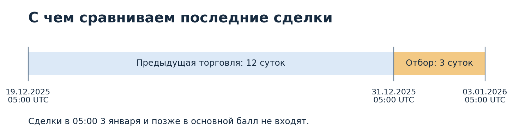
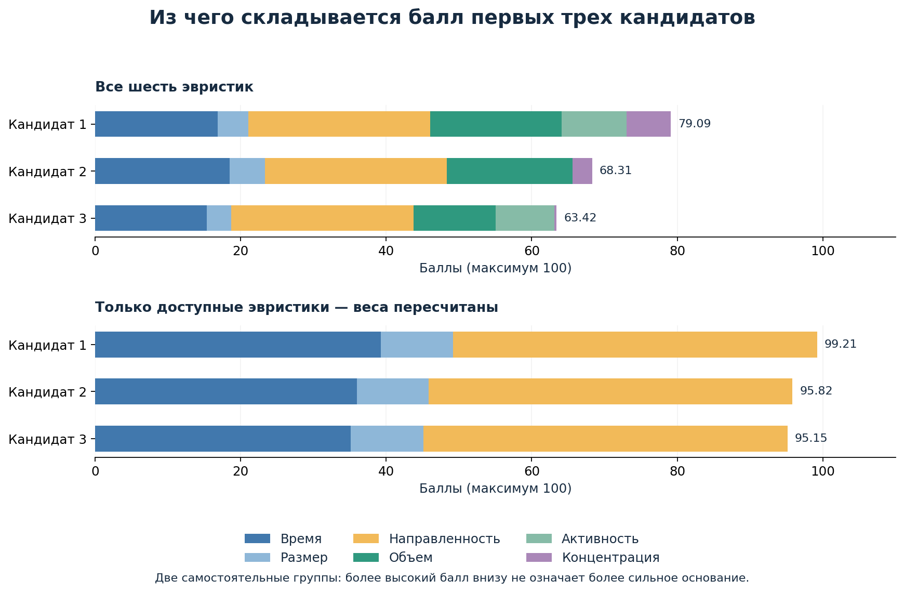

# Анализ рынка Polymarket об уходе Мадуро

Краткая версия. Подробности расчетов и описание файлов — в [полном отчете](README_rus.md).

## Содержание

1. [Цель анализа](#1-цель-анализа)
2. [Откуда взяты данные](#2-откуда-взяты-данные)
   - [2.1. Сделки и их подготовка](#21-сделки-и-их-подготовка)
   - [2.2. Выбор временной границы](#22-выбор-временной-границы)
3. [Отбор и оценка кандидатов](#3-отбор-и-оценка-кандидатов)
   - [3.1. Первичный отбор кошельков](#31-первичный-отбор-кошельков)
   - [3.2. История сделок кандидатов](#32-история-сделок-кандидатов)
   - [3.3. Расчет шести эвристик](#33-расчет-шести-эвристик)
   - [3.4. Построение двух рейтингов](#34-построение-двух-рейтингов)
4. [Что получилось и насколько результат устойчив](#4-что-получилось-и-насколько-результат-устойчив)
   - [4.1. Публичные упоминания кандидатов](#41-публичные-упоминания-кандидатов)
   - [4.2. Что меняется при других условиях](#42-что-меняется-при-других-условиях)
5. [Как повторить анализ](#5-как-повторить-анализ)

## 1. Цель анализа

Цель — найти кошельки, чья торговля перед событиями 3 января 2026 года в Венесуэле заслуживает проверки. Рынок — **«Уйдет ли Мадуро до 31 января 2026 года?»**: YES означает ставку на уход, NO — на противоположный исход.

Результат — **116 кандидатов в двух рейтингах**. Балл определяет приоритет проверки, но не доказывает использование закрытой информации.

## 2. Откуда взяты данные

### 2.1. Сделки и их подготовка

Источник — публичная база CryptoHouse, зеркало записей Polymarket, доступное через [ClickHouse](https://crypto-clickhouse.clickhouse.com/). Сохранены **19 911 исполнений** основного рынка за 27 декабря — 3 января. Один ордер может давать несколько исполнений.

Данные основного рынка выделены из ранее сохраненной выгрузки без новых запросов к базе. Анализируется **maker-сторона сделок**; участники, торговавшие только как taker, в отбор не входят.

### 2.2. Выбор временной границы

Граница расчета — **3 января, 05:00 UTC**: за час до начала действия [авиационного ограничения FAA](https://notams.aim.faa.gov/notamSearch/createNotamPdf?download=true&transactionid=79311384) со ссылкой на военную активность. Это рабочая граница, а не установленное время первого слуха; время первой публикации ограничения неизвестно.

Период отбора — трое суток перед границей; период сравнения — предшествующие 12 суток. Сделки в момент границы и позже исключены. Дополнительно проверяются границы 04:00 и 06:00.



## 3. Отбор и оценка кандидатов

### 3.1. Первичный отбор кошельков

В отбор входят кошельки с суммой **покупок YES и продаж NO не менее 100 USDC** за трое суток. Продажа NO может означать закрытие прежней позиции, а не новую ставку на уход. Обратные сделки учитываются позже, при оценке направленности.

Из **1 415 кошельков отобраны 116**.

### 3.2. История сделок кандидатов

Для кандидатов собраны **541 060 исполнений на всех рынках** за доступную часть периода с 1 декабря до 3 января, 06:00 UTC. Последний час нужен только для альтернативной границы. История позволяет сравнить недавнюю торговлю с предыдущим поведением.

В источнике нет записей за 1–17 декабря. Поэтому период сравнения начинается 19 декабря в 05:00. Отсутствие истории не доказывает, что кошелек новый.

### 3.3. Расчет шести эвристик

Каждый признак получает оценку от 0 до 1. Чем она выше, тем больше вклад в балл.

| Признак | Что повышает оценку | Вес |
|---|---|---:|
| Время | Покупки YES и продажи NO ближе к границе расчета. | 20% |
| Размер | Их суммарный оборот выше, чем у других участников. | 5% |
| Направленность | Торговля в пользу YES преобладает над обратной. | 25% |
| Собственный объем | Среднесуточный текущий оборот выше предыдущего типичного объема кошелька. | 20% |
| Активность | Среднее число транзакций в день на всех рынках выросло. | 15% |
| Концентрация | Выросла доля основного рынка в общем обороте кошелька. | 15% |

Для трех последних признаков нужна достаточная история. **Пропуск означает недостаток данных; ноль — наличие данных без сигнала по этому признаку.** Веса выбраны экспертно, а не обучены на доказанных случаях инсайда.

### 3.4. Построение двух рейтингов

У **84 кошельков** доступны все признаки: балл равен сумме оценок с весами, умноженной на 100. У **32 кошельков** есть пропуски: недоступные признаки исключены, оставшиеся веса пропорционально увеличены до суммы 100%.

Например, если доступны только время, размер и направленность, веса 20%, 5% и 25% становятся 40%, 10% и 50%. **Баллы двух групп напрямую не сравнимы.** В группе с пропусками важно также учитывать, какие признаки доступны конкретному кошельку.

Полные списки: [все признаки](results/ranking_complete.csv) и [есть пропуски](results/ranking_incomplete.csv).

## 4. Что получилось и насколько результат устойчив

Первые три кандидата каждой группы:

| Группа | № на графике | Кошелек | Балл |
|---|---:|---|---:|
| Все признаки | 1 | [0xe194…cd47](https://polygonscan.com/address/0xe194c638670b0a0acedc8efa00fc1c98aa49cd47) | 79,09 |
| Все признаки | 2 | [0x858d…1047](https://polygonscan.com/address/0x858d551d073e9c647c17079ad9021de830201047) | 68,31 |
| Все признаки | 3 | [0xee21…e2fe](https://polygonscan.com/address/0xee213de5ec7ab93c72bcad3c2c76552cb56de2fe) | 63,42 |
| Есть пропуски | 1 | [0x6baf…94c5](https://polygonscan.com/address/0x6baf05d193692bb208d616709e27442c910a94c5) | 99,21 |
| Есть пропуски | 2 | [0xa72d…ebd4](https://polygonscan.com/address/0xa72db1749e9ac2379d49a3c12708325ed17febd4) | 95,82 |
| Есть пропуски | 3 | [0x31a5…8ed9](https://polygonscan.com/address/0x31a56e9e690c621ed21de08cb559e9524cdb8ed9) | 95,15 |



Лидер полной группы получил баллы по всем шести признакам. Лидер группы с пропусками — только по времени, размеру и направленности. Его 99,21 не означает большей подозрительности, чем 79,09 в полной группе.

### 4.1. Публичные упоминания кандидатов

Поиск по первым пяти кошелькам каждого рейтинга обнаружил публичный разбор **трех лидеров группы с пропусками**. [BlockBeats](https://www.binance.com/en/square/post/34623684785378) оценивает их прибыль по Мадуро в $145,6 тыс., $75 тыс. и $409,9 тыс. соответственно. Эти сведения не участвовали в расчете баллов.

Адрес `0x31a5…8ed9` [Odaily связывает](https://www.binance.com/en/square/post/315888847860113) с Gannon Ken Van Dyke. [Минюст США](https://www.justice.gov/opa/pr/us-soldier-charged-using-classified-information-profit-prediction-market-bets) сообщил об обвинениях в использовании секретной информации для ставок, но полный адрес не указал. Связь адреса с человеком опирается на вторичную публикацию; обвинение не означает доказанную вину.

У второго кошелька полной группы найден ник flipfloppity. Его упоминание в [Prism News](https://www.prismnews.com/news/study-finds-143-million-in-suspected-insider-trading-on) о ставках на Иран остается неподтвержденной зацепкой: первичный разбор и совпадение полного адреса не установлены. Содержательных обсуждений остальных шести кошельков не найдено.

### 4.2. Что меняется при других условиях

Проверены **15 сценариев** с другими границами, периодами, весами, порогами и правилами обработки пропусков. Среди десяти сценариев изменения периода, границы, весов и требований к истории, включая основной расчет, лидер полной группы остается первым в **8**, лидер неполной — в **9**.

Проверка недельного отбора ограничена: он добавляет **83 кошелька без собранной истории**. Полный недельный рейтинг не рассчитан. Проверки сохраненных расчетов прошли.

Рейтинги дают список для дальнейшего разбора сделок. Сам по себе высокий балл не позволяет отличить инсайд от удачной спекуляции, хеджирования или изменения стратегии.

## 5. Как повторить анализ

Из папки проекта, с Python 3.13:

```powershell
python -m pip install -r requirements.txt
python src/run.py
python src/plot_report.py
```

Расчет использует сохраненные данные без обращения к сети. Последняя команда обновляет графики. Параметры находятся в [config.json](config.json); подробности сбора данных — в [полном отчете](README_rus.md#5-как-повторить-анализ).
