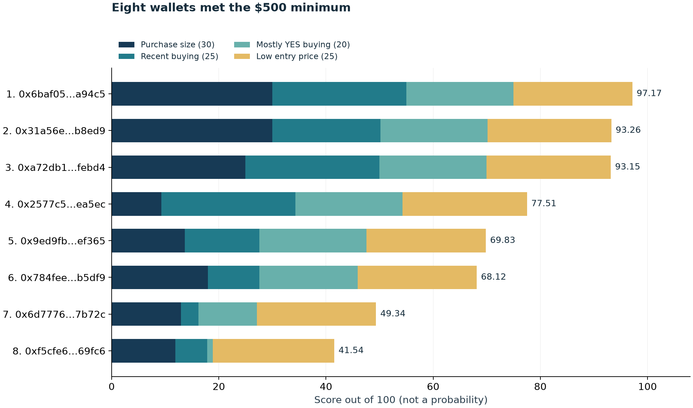
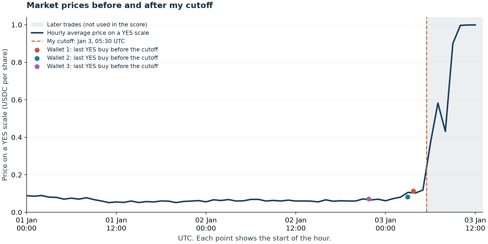

# Polymarket wallet review

I used the same scoring method to review trading before Maduro's removal and Thailand's February 2026 election. The Maduro case is already public. In the [Thailand follow-up](THAILAND.md), I found a wallet that bought $124,136.47 of Bhumjaithai YES shares before election-day polling opened. My search found an automated profile for that wallet, but no press investigation of its election trades.

## Trading before Maduro's removal

I analysed the ["Maduro out by January 31, 2026?" market](https://polymarket.com/event/maduro-out-in-2025/maduro-out-by-january-31-2026-318) on Polymarket. Three wallets stood out for buying large amounts of YES at low prices shortly before the events of 3 January 2026. Their scores were 97.17, 93.26 and 93.15 out of 100.

These are my first three candidates for follow-up. The score measures how closely their trading fits the selected patterns; it is not a probability of insider trading.

## Data

I collected 9,367 trade records from 3,533 wallets, with a total value of $4,540,176.76. The requested period ran from 11 December 2025 at 00:00 UTC to 4 January 2026 at 00:00 UTC, excluding the end time. The saved market data show a start date of 12 December and a YES result, with the market closing on 3 January at 12:14:07 UTC. [Market details](data/market.json), [trade data](artifacts/trades.csv).

For the ranking, I used trades strictly before **3 January 2026 at 05:30 UTC**, focusing on the preceding 24 hours. This left 4,867 records from 2,278 wallets. Reuters placed the start of visible disturbances in Caracas at about 06:00 UTC, so I left a 30-minute gap. Earlier public reports or local information may still have been available. [Reuters report](https://en.aletihad.ae/news/mena-world/4634580/venezuela-s-capital-hit-by-explosions--smoke-seen).

I used the public [trade API](https://docs.polymarket.com/api-reference/core/get-trades-for-a-user-or-markets) with `takerOnly=true`, so the ranking covers wallets accepting existing orders. Maker trades are excluded, and one API record can combine several fills. The $4.54 million total is the value of these records, rather than the market's full reported volume.

I split periods returning 1,000 rows until each response fell below the API limit. The final 17 periods have no gaps or overlaps, and the market file has no repeated transaction hashes. Saved responses, request URLs, collection times and file hashes allow the download to be checked. They cannot establish whether the source API omits any blockchain trades. [Download records](artifacts/coverage.csv), [source log](data/request_manifest.jsonl).

I also collected trade histories for ten wallets from 1 November 2025 to the same cutoff: the eight that met the $500 spending minimum and two just below it. The [activity API](https://docs.polymarket.com/api-reference/core/get-user-activity) returned 18,325 records. These histories overlap with the market file and are not added to its trade count. They include trades but not deposits, transfers or payouts. [Wallet histories](artifacts/history/).

## Score

The score combines purchase size, recent buying, the share of trading spent on YES purchases and entry price.

For each wallet, C is the amount spent on YES in the final 24 hours, Q is the number of shares bought, and P = C/Q is the average entry price. L is all collected YES purchase value before the cutoff. A is the value of all trades in the final 24 hours, including buys and sells of YES and NO. All values refer to this market and use USDC.

| Sign | Value, from 0 to 1 | Maximum points |
|---|---|---:|
| Purchase size | min(1, ln(1+C/500) / ln(21)) | 30 |
| Recent buying | C/L | 25 |
| Mostly YES buying | C/A | 20 |
| Low entry price | 1-P | 25 |

The score is the weighted sum of these four values. Size points grow logarithmically and reach their cap at $10,000. Missing data or a zero denominator give that part zero points.

A wallet must spend at least $500 on recent YES purchases to receive a score above zero. Eight wallets met this minimum. The others remain in the ranking with `eligible=false`. Their zero score only means they did not meet this rule. Equal scores are sorted by recent YES spending and then by address.

I set the weights manually. They have not been fitted to confirmed insider cases, and recent buying can overlap with the mostly-YES signal. Wallet histories provide context but do not enter the score. [Settings](config.json), [scoring code](src/analyze.py).

## Findings

The amounts below cover the final 24 hours before 05:30 UTC. Prices are per YES share. [Full ranking](artifacts/ranking.csv), [supporting trades](artifacts/top10_trade_evidence.csv).

| Rank | Wallet | Score | YES purchases | Average price | Last purchase, UTC |
|---:|---|---:|---:|---:|---|
| 1 | [0x6baf05...a94c5](https://polymarket.com/profile/0x6baf05d193692bb208d616709e27442c910a94c5) | 97.17 | $10,000.00 | 0.11308 | Jan 3, 03:42:01 |
| 2 | [0x31a56e...b8ed9](https://polymarket.com/profile/0x31a56e9e690c621ed21de08cb559e9524cdb8ed9) | 93.26 | $26,215.00 | 0.07523 | Jan 3, 02:58:25 |
| 3 | [0xa72db1...febd4](https://polymarket.com/profile/0xa72db1749e9ac2379d49a3c12708325ed17febd4) | 93.15 | $5,782.66 | 0.07160 | Jan 2, 21:44:21 |
| 4 | [0x2577c5...4ea5ec](https://polymarket.com/profile/0x2577c59314e3efd45f9dd31067ea329d5a4ea5ec) | 77.51 | $779.68 | 0.07000 | Jan 2, 07:49:55 |
| 5 | [0x9ed9fb...ef365](https://polymarket.com/profile/0x9ed9fb24166d7aae9ec0f8eef267c46cb34ef365) | 69.83 | $1,499.19 | 0.10870 | Jan 3, 04:08:15 |

**0x6baf05...a94c5** bought 88,433.40 YES shares for $10,000 at 03:42:01. Six minutes later, at 03:48:21, it spent another $15,089.94 on YES in the February Maduro market. Those are its only two trades in the collected history. The size and timing stand out, but both bets depend on the same event. They are not two independent successful predictions. [History](artifacts/history/0x6baf05d193692bb208d616709e27442c910a94c5.csv), [first transaction](https://polygonscan.com/tx/0x4db86bda9fb22c0c51abb77d59deeac7574d5bc51adcf84228c7abe57e304bb4).

**0x31a56e...b8ed9** made 13 trades across four Venezuela-related markets, starting on 27 December. It spent $33,934.34 on buys, of which $32,538.34, or 95.89%, went to the selected market. Four YES purchases worth $26,215.00 fell in the final 24 hours. The last three were about $6,000, $7,000 and $7,215. I would check what public information was available at each purchase, since the wallet built its position over several trades. [History](artifacts/history/0x31a56e9e690c621ed21de08cb559e9524cdb8ed9.csv), [last transaction](https://polygonscan.com/tx/0x78d0e84d2e4626da896825c067f02b146c979c52d9ad597d85572c4593a8a6e6).

**0xa72db1...febd4** bought 80,764.94 YES shares for $5,782.66 at 21:44:21 on 2 January. This is its only trade in the collected history, so there is little context for judging the decision. Older trades, other wallets and opposite positions elsewhere remain unchecked. [History](artifacts/history/0xa72db1749e9ac2379d49a3c12708325ed17febd4.csv).

Wallet 7 had 8,222 records across 64 markets, with only 0.245% of its observed buy spending in this market. Wallet 8 had 8,066 records across 125 markets. These broad trading histories make them lower priorities than the three wallets above. [History comparison](artifacts/top10_history_context.csv).

## Checks and limits

Moving the cutoff to 04:30 or 05:00 kept the same three wallets at the top in the same order. Moving it to 06:00 brought another wallet into second place, leaving the original three at ranks 1, 3 and 4. They also stayed in the top four with 12-hour and 48-hour windows, equal weights, and no size points. The group is more stable than its exact order. [Results with other settings](artifacts/sensitivity.csv).

I repeated the scoring at seven earlier daily cutoffs. None had a score of 90 or more, compared with three wallets in the event window. Three earlier windows did have scores of at least 80, including four wallets on 31 December. High scores also occur away from the event. Without confirmed labels for these traders, this comparison cannot measure a false-positive rate. The levels 80 and 90 are descriptive thresholds. [Earlier-day results](artifacts/earlier_day_comparisons.csv).

The chart shows hourly averages weighted by share count. NO prices are converted to `1-price`. Trades after the cutoff show the later market reaction and do not enter the score. A wallet's own trades can affect the average. [Chart data](artifacts/hourly_market.csv).

The CSV's `buy_and_hold_upside_scenario_usdc` column also includes a possible return if every recent YES share was held for a $1 payout with no costs. Wallet 2's value is $322,239.90. This is not actual profit and is not part of the score. Sales, transfers, fees and other positions could change the real result.

I selected the Maduro case after the outcome was known and downloaded the data later. The API may have changed since the event. I did not decode blockchain receipts for this case or identify the wallet owners. A first observed trade also cannot establish an account's creation date.

The [Thailand follow-up](THAILAND.md) applies the same method to a separate event and includes one receipt check. Both cases produce candidates for investigation; neither establishes access to inside information. Funding and transfer histories would help assess the wallets. Testing across a wider set of events would be needed to assess the method itself.
