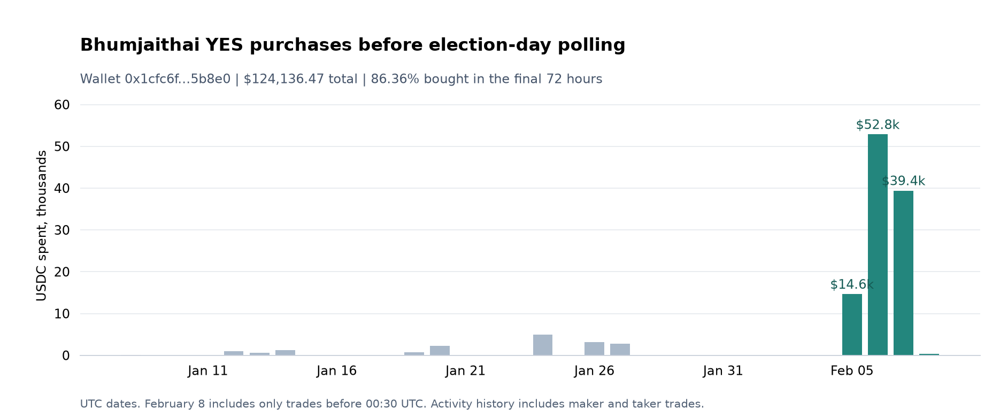

# Bhumjaithai purchases before Thailand's election

I checked trading before Thailand's election on 8 February 2026 using the same score as in the Maduro case. My main lead is [0x1cfc6f041b5b8dad3c14b867be8482a69d45b8e0](https://polymarket.com/profile/0x1cfc6f041b5b8dad3c14b867be8482a69d45b8e0). It ranked second, but its trading history made it the first wallet I would investigate.

Before election-day polling opened, the wallet bought **$124,136.47** of YES shares on Bhumjaithai winning the most seats. **86.36%** of that spending fell in the last 72 hours before my cutoff. Its collected history covers just two markets, both from this election. Bhumjaithai won, while the wallet's other bet, on Pheu Thai, lost. [Wallet history](cases/thailand/artifacts/history/0x1cfc6f041b5b8dad3c14b867be8482a69d45b8e0.csv), [election results](https://data.ipu.org/parliament/TH/TH-LC01/election/TH-LC01-E20260208/).

The concentrated buying deserves a closer look. The score alone is less convincing: earlier days in the same market produced higher scores. I found no press investigation of this wallet's election trades in my search, although an automated trading site already lists its Bhumjaithai position.

## Data and cutoff

The [market](https://polymarket.com/event/thai-legislative-election-winner/will-bhumjaithai-party-bjt-win-the-most-seats-in-the-2026-thai-legislative-election) settled on the party winning the most seats, rather than the next prime minister.

I set the cutoff at **8 February, 00:30 UTC**, or **07:30 in Thailand**, before downloading the trades. This is 30 minutes before the scheduled opening of election-day polling. Advance voting had already taken place on 1 February. [Official schedule](https://thailand.prd.go.th/en/content/category/detail/id/48/iid/457218).

The download covers 16 December 2025 to 10 February 2026, excluding the end time: **10,053 taker trade records**, **1,375 wallets** and **$1,862,278.40** in recorded value. There are **6,555 records from 784 wallets** before the cutoff. Four wallets met the $500 minimum for YES purchases in the final 24 hours.

All 17 final download periods are below the API limit, with no gaps or overlaps. This verifies the collection process; missing records in the source API would still be a limitation. [Trades](cases/thailand/artifacts/trades.csv), [coverage](cases/thailand/artifacts/coverage.csv), [request log](cases/thailand/data/request_manifest.jsonl).

## Ranking and wallet review

I reused the Maduro scoring function, weights and 24-hour window. The score combines purchase size, recent buying, the share of trading spent on YES purchases and entry price. The amounts below are taker purchases in that window. [Code](src/thailand.py), [settings](cases/thailand/config.json).

| Rank | Wallet | Score | YES purchases | Average price |
|---:|---|---:|---:|---:|
| 1 | 0x61f285...88519 | 80.76 | $2,000.00 | 0.20390 |
| 2 | 0x1cfc6f...5b8e0 | 80.20 | $10,243.79 | 0.20127 |
| 3 | 0x05a4ba...427cf | 68.41 | $625.83 | 0.19000 |
| 4 | 0x0224bb...48292a | 65.80 | $761.17 | 0.21637 |

[Full ranking](cases/thailand/artifacts/ranking.csv), [supporting trades](cases/thailand/artifacts/top10_trade_evidence.csv).

Wallet 2 stood out for its focus on this election. The earlier 100-record sample for wallet 1 spans 19 markets, including Bitcoin bets; that sample is incomplete. Wallets 3 and 4 traded in 23 and 344 markets in their collected histories. Wallet 3 also bought $3,120 of YES on the People's Party on 7 February. [Wallet 1 sample](cases/thailand/artifacts/history_sample/0x61f2853af4d13ff71d7a3c9dc5f1a5f6e7788519-earliest.csv), [history comparison](cases/thailand/artifacts/top10_history_context.csv).

For wallet 2, the history request runs from 1 November 2025 to the cutoff. It returned **2,225 trade records**, with the first on **8 January**. This establishes the first observed trade in the period, not the account's creation date. Every record is a YES purchase; there are no sales.

| Outcome bought | Records | Spending | Shares bought |
|---|---:|---:|---:|
| Bhumjaithai wins the most seats | 1,529 | $124,136.47 | 454,778.39 |
| Pheu Thai wins the most seats | 696 | $14,072.53 | 355,258.66 |

Bhumjaithai accounts for **89.82%** of the wallet's buy spending, at an average price of **0.27296**. It spent **$107,198.33** on that outcome in the final 72 hours. [Calculated totals](cases/thailand/artifacts/focus_summary.json), [daily purchases](cases/thailand/artifacts/focus_daily_trades.csv).

These larger totals come from the activity endpoint, which includes maker and taker trades. The ranking uses the taker-only market file. The two sources overlap and their amounts cannot be added together.

I checked one large purchase against its Polygon receipt. At **06:19:47 UTC on 7 February**, the wallet paid **6,257.7547 USDC** and received **32,520.52 YES shares**. The net USDC and share transfers, token ID and timestamp match the API record. This check covers one transaction. [Transaction](https://polygonscan.com/tx/0x8c2ad462a25e188971194b19218a9fa6a5ff640d6bc29a353160187545fe4204), [saved receipt and block](cases/thailand/data/transaction_check.json), [check result](cases/thailand/artifacts/transaction_check.json).

I have not calculated actual profit or final holdings. That would require transfers, redemptions and other positions. The losing Pheu Thai purchases also matter: this is one election with two related bets, not evidence of repeated successful predictions.

## Checks against public information

Bhumjaithai had public support before the election. Naewna reported a market price near 31% from a 5 February snapshot. Public polls, local research or a different view of seat allocation could explain the wallet's buying. [Naewna, 6 February](https://www.naewna.com/politic/columnist/65411).

NIDA's projection put Bhumjaithai first with 140 to 150 seats, based on a survey from 31 January to 6 February. The Nation reported that it was released after polls closed at 17:00 on 8 February. I found no evidence connecting the wallet to NIDA or identifying its information source. [NIDA survey](https://nidapoll.nida.ac.th/polls/nida-poll-election-2026-forecast-thailand/), [release timing](https://www.nationthailand.com/news/politics/40062274).

Three of the seven earlier daily windows had scores of at least 80. The highest was **85.79**, compared with **80.76** in the event window; none of the eight windows reached 90. High scores were therefore already present in earlier trading. These comparisons do not establish whether any trader had inside information. [Earlier-day results](cases/thailand/artifacts/earlier_day_comparisons.csv).

Wallet 2 stays second with the cutoff 30 or 60 minutes earlier, and third with it 30 minutes later. It ranks first with 12-hour and 48-hour windows, second with equal weights and fourth without size points. Its 12-hour score falls to **65.18**. The wallet remains near the top, but the score depends on the chosen settings. [Sensitivity results](cases/thailand/artifacts/sensitivity.csv).

## Prior coverage and conclusion

I selected the wallet from the trade ranking and history review. On **15 October 2026 UTC**, I searched its full address, profile name `86shin`, and English and Thai terms for the election and possible insider trading. The results included general election coverage and an [automated Polycopy profile](https://polycopy.app/trader/0x1cfc6f041b5b8dad3c14b867be8482a69d45b8e0), but no press investigation of these purchases. This is limited to the returned search results, particularly for Thai-language reporting and social posts. [Search notes](cases/thailand/RESEARCH.md).

I would follow up on the wallet because of its concentrated spending and the increase before election day. The losing bet, public support for Bhumjaithai and high earlier-day scores all weaken the insider hypothesis. The next useful check is its funding and transfer history, including possible links to other trading wallets. The current evidence does not establish access to private information.

This case was selected after the election result was known. It provides a separate lead from Maduro, but cannot measure how often the method would work on new events.
